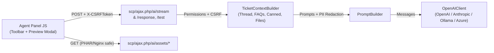
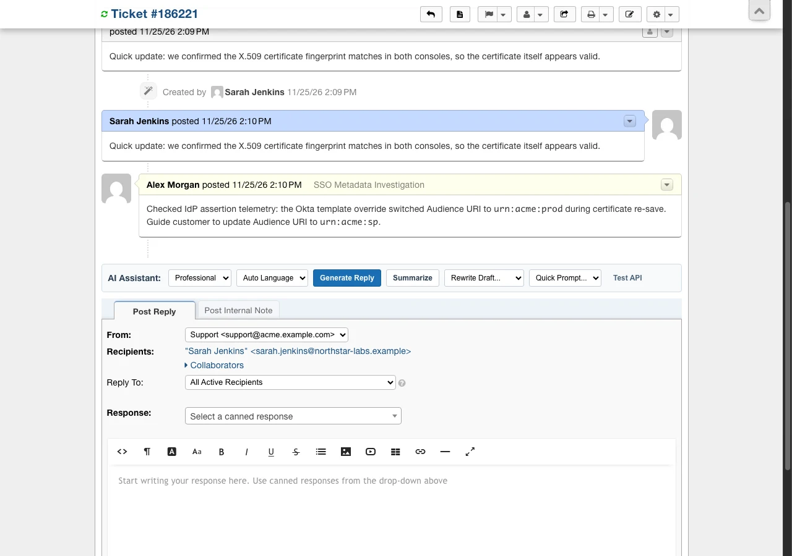
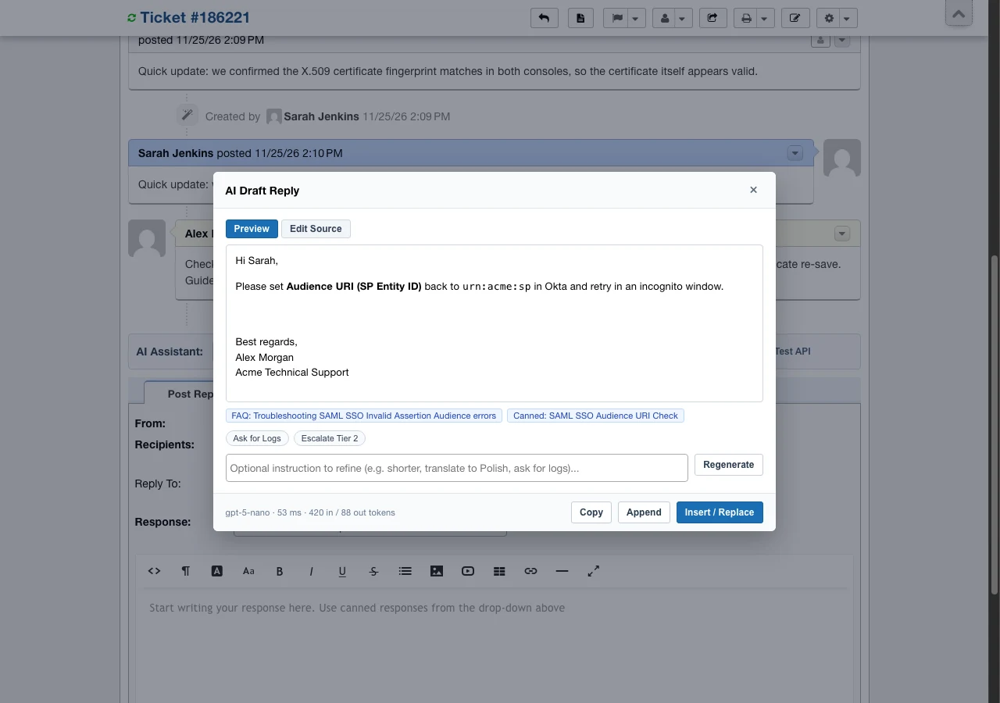
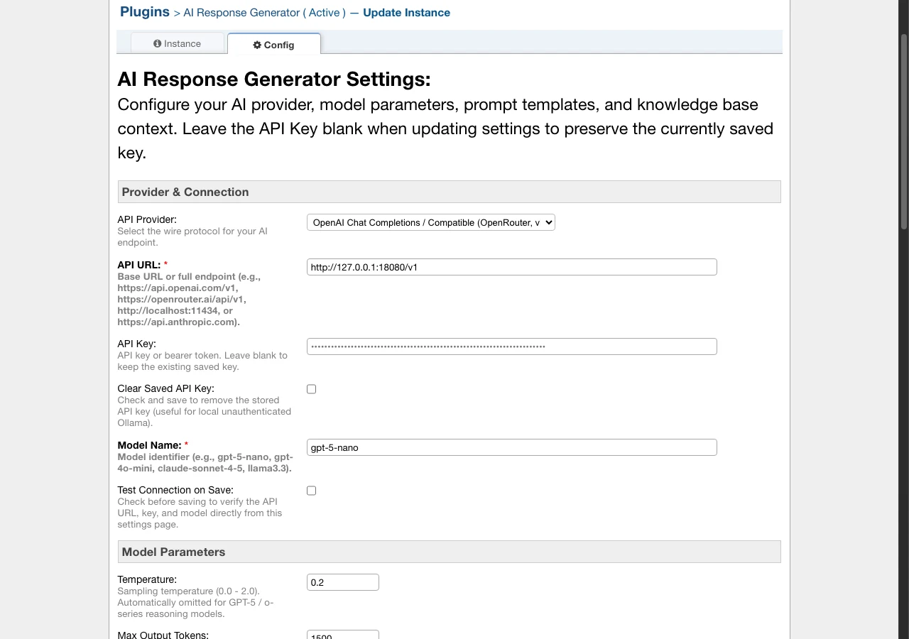

<div align="center">

# AI Response Generator for osTicket

**Draft replies, summarize threads, and rewrite responses inside osTicket using OpenAI, Anthropic, Ollama, or any OpenAI-compatible API**

[](https://github.com/mhajder/ai-response-generator/releases/latest)
[](https://github.com/mhajder/ai-response-generator/releases)
[](https://github.com/mhajder/ai-response-generator/blob/main/LICENSE)
[](https://github.com/mhajder/ai-response-generator/stargazers)

[](https://github.com/mhajder/ai-response-generator/actions/workflows/ci.yml)
[](https://github.com/mhajder/ai-response-generator/actions/workflows/pre-commit.yml)
[](https://osticket.com/)
[](https://www.php.net/)

[Features](#-features) · [Providers](#-supported-providers) · [Installation](#-installation) · [Usage](#-usage) · [Configuration](#-configuration) · [Security](#%EF%B8%8F-security) · [Development](#%EF%B8%8F-development)

</div>

An AI assistant plugin for **osTicket 1.17 / 1.18+ (PHP 8.2–8.4)** that brings reply drafting, ticket summarization, draft rewriting/translation, Knowledge Base matching, and custom RAG context directly into the osTicket Agent Panel.

## ✨ Features

### Agent Workflow

- **Inline AI Toolbar & "More" Menu**: Works directly above the ticket reply editor (with full PJAX navigation support) as well as inside the ticket **More** dropdown.
- **Generate Reply**: Drafts customer-ready replies with selectable tones (_Default_, _Professional_, _Friendly_, _Concise_, _Technical_), optional direct reply language override, browser-persisted profile/tone/language preferences, smooth live HTML SSE streaming preview with clean cancellation (`AbortController`), non-blank overwrite confirmation, grounded KB/redaction source pills, and a footer badge showing model, latency, and token usage.
- **Quick Action Presets**: Define reusable one-click agent instructions (`Label | Instruction`) available in both the toolbar dropdown and preview modal refine chips.
- **Summarize Ticket**: Generates a structured summary (_Issue_, _Key Details_, _Current Status_, _Next Steps_, or a custom summary prompt) and inserts it straight into the **Internal Note** editor.
- **Rewrite & Translate Draft**: Polishes, shortens, changes tone, or translates an agent's existing draft via an in-modal language picker.
- **Redactor v2, Redactor v3 & Plain Text**: Automatically adapts to osTicket's rich-text editor (`$R` / `$.redactor`) or plain `<textarea>`, preserving formatting and triggering draft autosave.
- **Admin Connectivity Check**: Verify settings directly on save (**Test Connection on Save**) or via the one-click **Test API** button in the ticket toolbar (visible to admins).

### Context & Multi-Instance Intelligence

- **Recent Chronological Thread Window & Attachment Context**: Pulls the latest _N_ thread entries in chronological order, includes non-inline attachment filenames/sizes/types, caps oversized messages cleanly, and converts HTML thread bodies to plain text.
- **Optional PII Redaction**: Enable **Redact PII Before Sending** to mask email addresses, phone numbers, Luhn-valid payment cards, and IPv4 addresses before sending ticket context to external AI providers.
- **Internal Note Safety**: Excludes internal staff notes by default; when enabled, labels them clearly as internal-only context so the model never treats them as sent replies.
- **Ticket Metadata, Custom Forms & osTicket KB**: Optionally injects ticket subject, department, help topic, priority, status, organization, custom dynamic form fields, custom RAG text, and top keyword-matched published FAQs or Canned Responses.
- **Diagnostic Logging**: Optional non-PII logging of provider, model, latency, and token usage (including streamed OpenAI usage) to osTicket system logs.
- **Multi-Instance & Department Scoping**: Configure multiple active plugin instances (e.g., _Billing GPT-5_, _IT Local Ollama_) and optionally restrict each instance to specific numeric department IDs.

## 🤖 Supported Providers

| Provider                     | Setting Value      | Endpoint Pattern                       | Notes                                                                                                                      |
| ---------------------------- | ------------------ | -------------------------------------- | -------------------------------------------------------------------------------------------------------------------------- |
| **Auto-detect**              | `auto`             | Inferred from API URL                  | Default; detects `/responses`, `anthropic.com`, `.openai.azure.com`, `/api/chat`, or defaults to Chat Completions          |
| **OpenAI Chat / Compatible** | `openai_chat`      | `.../chat/completions`                 | Works with OpenAI, OpenRouter, vLLM, LM Studio, Groq, Together                                                             |
| **OpenAI Responses API**     | `openai_responses` | `.../responses`                        | Extracts system instructions and parses `output_text` / `output` items                                                     |
| **Anthropic Messages**       | `anthropic`        | `.../v1/messages`                      | Sends `x-api-key` and `anthropic-version: 2023-06-01`                                                                      |
| **Ollama Native**            | `ollama`           | `.../api/chat`                         | Streaming NDJSON (`stream: true`) & non-streaming chat with `options.temperature`, `options.num_predict`, and token counts |
| **Azure OpenAI**             | `azure_openai`     | `.../chat/completions?api-version=...` | Sends `api-key` header and preserves or appends `api-version`                                                              |

> [!TIP]
> Reasoning and GPT-5 models (`gpt-5*`, `o1*`, `o3*`, `o4*`) are detected automatically: `max_tokens` is mapped to `max_completion_tokens`, unsupported `temperature` values are omitted, and `reasoning_effort` is forwarded when configured. An automatic HTTP 400 fallback also adapts unknown models dynamically.

## 🏗️ Architecture



## 📦 Installation

### Option 1: `.phar` Archive (Recommended)

1. Download `ai-response-generator.phar` from the [latest GitHub Release](https://github.com/mhajder/ai-response-generator/releases/latest).
2. Verify the download checksum using `SHA256SUMS` from the same release:

   ```sh
   sha256sum --check --ignore-missing SHA256SUMS
   ```

3. Copy `ai-response-generator.phar` into your osTicket `include/plugins/` directory.
4. In the osTicket Admin Panel, open **Manage → Plugins → Add New Plugin** and install **AI Response Generator**.
5. Open the plugin, click **Add New Instance**, set **Status** to **Active**, save, and then configure/review checkboxes on the **Update Instance** screen.

> [!IMPORTANT]
> In osTicket 1.18 core (`Plugin::addInstance`), creating a brand-new plugin instance builds the dynamic config form twice in the same POST request, which shifts ephemeral checkbox field IDs (`_field-checkboxes[]`). Always verify or toggle boolean checkboxes after creation by saving once more on the instance's **Config** tab.

### Option 2: Unpacked Directory

1. Download `ai-response-generator-vX.Y.Z.zip` from [GitHub Releases](https://github.com/mhajder/ai-response-generator/releases) and extract it to `include/plugins/ai-response-generator/`.
2. Install and enable an active instance under **Admin Panel → Manage → Plugins**.

> [!NOTE]
> Because JS and CSS assets are served through osTicket's `scp/ajax.php/ai/assets/...` endpoint, no custom Apache `.htaccess` or Nginx `/include/` allow-rules are required.

## 🚀 Usage

1. Open any ticket in the osTicket Agent Panel.
2. Use the inline **AI Assistant** toolbar above the reply box (or choose **AI Reply** / **AI Summarize** under **More**):
   - **Generate Reply**: Pick an optional tone, target **Reply Language** (defaults to _Match Customer_), or a configured **Quick Prompt...** preset, then click **Generate Reply**. Preview the live streamed output along with grounded FAQ/Canned badges, PII redaction indicator, and model/latency/token usage metadata; refine with a follow-up instruction or quick chip, **Copy** to clipboard (with non-HTTPS HTTP fallback), or insert into `#response` (non-blank drafts require a two-step **Confirm Replace** before overwriting).
   - **Summarize**: Click **Summarize** to draft an internal summary and insert it into the **Internal Note** tab (`#note`).
   - **Rewrite Draft**: Type a rough draft in `#response` and select _Polish & Improve_, _Make Shorter_, _More Formal_, _Warmer / Friendly_, or _Translate Draft..._.
   - **Test API** _(Admins)_: Verify connectivity, resolved provider, and latency directly from the toolbar.

## 🔧 Configuration

### Connection & Model Settings

| Setting                   | Description                                                                                      | Default                     |
| ------------------------- | ------------------------------------------------------------------------------------------------ | --------------------------- |
| `provider`                | Wire protocol (`auto`, `openai_chat`, `openai_responses`, `anthropic`, `ollama`, `azure_openai`) | `auto`                      |
| `api_url`                 | Base URL or full endpoint URL                                                                    | `https://api.openai.com/v1` |
| `api_key`                 | Masked API key (`PasswordWidget`); leave blank on save to keep existing key                      | —                           |
| `clear_api_key`           | Check and save to remove the stored API key                                                      | `false`                     |
| `model`                   | Model ID (e.g. `gpt-5-nano`, `gpt-4o-mini`, `claude-sonnet-4-5`, `llama3.3`)                     | —                           |
| `test_connection_on_save` | Run an API health check while saving plugin settings                                             | `false`                     |
| `temperature`             | Sampling temperature (`0.0` – `2.0`; omitted for reasoning models)                               | `0.2`                       |
| `max_tokens`              | Max output tokens (`64` – `32768`)                                                               | `1500`                      |
| `reasoning_effort`        | Optional reasoning effort (`low`, `medium`, `high`)                                              | Provider default            |
| `timeout`                 | HTTP timeout in seconds (`5` – `300`)                                                            | `45`                        |
| `output_format`           | Editor output mode (`auto`, `html`, `text`)                                                      | `auto`                      |
| `default_tone`            | Preselected reply tone in the ticket toolbar                                                     | Neutral                     |
| `enable_streaming`        | Stream reply tokens live via SSE into the preview modal                                          | `false`                     |

### Context, Prompts & Feature Toggles

| Setting                    | Description                                                                  | Default                 |
| -------------------------- | ---------------------------------------------------------------------------- | ----------------------- |
| `system_prompt`            | Custom instructions for tone, policy, and reply style                        | Built-in agent prompt   |
| `summary_prompt`           | Optional instructions used specifically for ticket summarization             | Built-in summary prompt |
| `response_template`        | Optional wrapper template applied to generated replies                       | —                       |
| `rag_content`              | Custom knowledge base / SOP context (up to 20,000 characters)                | —                       |
| `max_thread_entries`       | Number of most recent thread entries included (`1` – `100`)                  | `20`                    |
| `include_ticket_metadata`  | Include ticket number, subject, department, topic, priority, status, and org | `true`                  |
| `include_custom_fields`    | Include non-empty custom osTicket form answers                               | `true`                  |
| `include_internal_notes`   | Include internal staff notes (tagged internal-only)                          | `false`                 |
| `include_kb_faqs`          | Inject top keyword-matched published osTicket FAQ articles                   | `false`                 |
| `include_canned_responses` | Inject top keyword-matched enabled osTicket Canned Responses                 | `false`                 |
| `enable_summarize`         | Enable ticket summarization to internal notes                                | `true`                  |
| `enable_rewrite`           | Enable draft rewriting and translation                                       | `true`                  |
| `redact_pii`               | Mask emails, phone numbers, Luhn-valid cards, and IPv4s before API calls     | `false`                 |
| `quick_prompts`            | Newline-separated one-click presets (`Label \| Instruction`, up to 8)        | —                       |
| `enable_debug_log`         | Log latency, model, and token counts (no PII/keys) to osTicket system logs   | `false`                 |
| `department_ids`           | Optional comma-separated numeric department IDs allowed to use this instance | All departments         |

### Supported Template Tokens

`Response Template` expands the following placeholders:

- `{ai_text}` — Generated AI reply text
- `{ticket_number}` — Ticket number
- `{ticket_subject}` — Ticket subject
- `{ticket_department}` — Department name
- `{ticket_priority}` — Priority level
- `{ticket_status}` — Ticket status
- `{user_name}` — Ticket owner name
- `{user_email}` — Ticket owner email
- `{user_org}` — Customer organization name
- `{agent_name}` — Current staff agent name

<details>
<summary>Example provider configurations</summary>

- **OpenAI (GPT-5 / GPT-4o)**: Provider `auto`, URL `https://api.openai.com/v1`, Model `gpt-5-nano`
- **OpenRouter**: Provider `openai_chat`, URL `https://openrouter.ai/api/v1`, Model `openai/gpt-4o-mini`
- **Anthropic**: Provider `anthropic`, URL `https://api.anthropic.com`, Model `claude-sonnet-4-5`
- **Ollama (local)**: Provider `ollama`, URL `http://localhost:11434`, Model `llama3.3` (API Key blank)
- **Azure OpenAI**: Provider `azure_openai`, URL `https://<resource>.openai.azure.com/openai/deployments/<deployment>/chat/completions?api-version=2024-10-21`

</details>

## 📸 Screenshots

### Agent Ticket View & Inline AI Toolbar



### AI Draft Preview & Refine Modal



<details>
<summary>Plugin Configuration (Provider, Model & Context Settings)</summary>



</details>

## 🛡️ Security

- Enforces staff authentication (`$thisstaff->isStaff()`), ticket role permissions (`Ticket::PERM_REPLY` for replies/rewrites), and optional department scoping on every request.
- Validates osTicket CSRF tokens via `$ost->validateCSRFToken()` (`X-CSRFToken` / `__CSRFToken__`) with `$ost->checkCSRFToken()` fallback on all AJAX `POST` actions.
- Encrypts stored API keys at rest using osTicket `Crypto::encrypt()` with `SECRET_SALT`, masks input with `PasswordWidget`, and preserves existing secrets when saving unrelated settings.
- Sanitizes streamed/generated preview HTML in the browser with `sanitizePreviewHtml()` (`DOMParser`, stripping unsafe elements, `on*` handlers, and `javascript:`/`vbscript:`/`data:` URIs), escapes metadata template tokens in HTML mode, and renders notices via `textContent`.
- Supports optional outbound PII redaction (`redact_pii`) across ticket context, attachment metadata, drafts, and custom refinement instructions before sending prompts to external providers.

See [SECURITY.md](SECURITY.md) for private vulnerability reporting guidelines.

## 🛠️ Development

```sh
git clone https://github.com/mhajder/ai-response-generator.git
cd ai-response-generator
composer install
pnpm install
prek install

# PHP checks & tests
composer lint
composer cs-check
composer stan
composer test

# JS/CSS checks & tests
pnpm test
pnpm run check

# Build .phar and .zip archives into dist/
php -dphar.readonly=0 scripts/build-package.php
```

## 🤝 Contributing

Contributions are welcome! See [CONTRIBUTING.md](CONTRIBUTING.md) for development setup, test requirements, and [Conventional Commits](https://www.conventionalcommits.org/) guidelines.

## 📄 License

MIT License — see [LICENSE](LICENSE).
